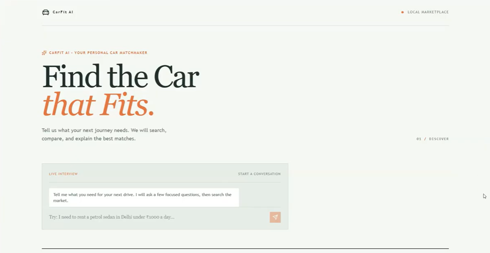
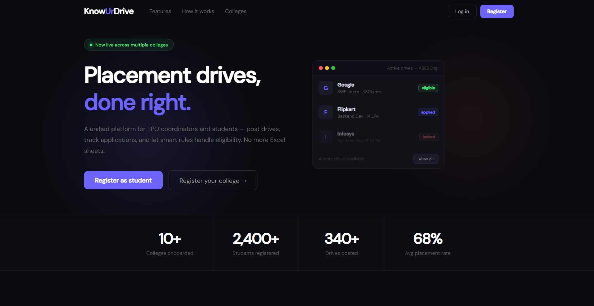
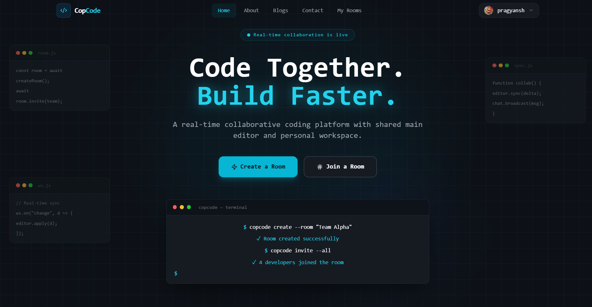

<!-- ============================================================
  GitHub Profile README
  Repo name must be EXACTLY your username: pragyanshgupta001
  Search for "TODO" to find the links still to add (CarFit live demo, portfolio site).
  Screenshots expected at: assets/carfit.png, assets/knowurdrive.png, assets/copcode.png
============================================================ -->

 

---

## 👨‍💻 About Me

<table>
<tr>
<td width="200" align="center">
  
    
  <b>Pragyansh Gupta</b> 
  Aligarh, India 🇮🇳
</td>
<td>

I'm a **Computer Science and Engineering student (BTech, graduating 2027)** at **Zakir Hussain College of Engineering and Technology, AMU**, who loves building things that actually get used.

- 🔭 I build **full-stack web apps** (MERN), **real-time systems**, and **AI agent applications** with **LangChain, LangGraph and the Model Context Protocol (MCP)**
- 🏗️ I make **role-based platforms** that digitize real workflows like placement drives, applications and notices
- 🧠 Strong foundation in **DSA, DBMS, Operating Systems and Computer Networks**
- 🎯 **Open to internships and jobs** in enterprise AI, hybrid cloud and technology consulting
- 📚 Currently exploring **agentic AI, MCP Apps and generative UI (A2UI)**

</td>
</tr>
</table>

---

## 🛠️ Tech Stack

### Languages

  

### Frontend

  
  
  

### Backend and Databases

  
  
  
  

### AI and Machine Learning

  
  
  
  
  
  

### DevOps and Tools

  

### Core CS
`Data Structures & Algorithms` · `OOP` · `DBMS` · `Operating Systems` · `Computer Networks`

---

## 🚀 Featured Projects

### 🚗 CarFit AI: Multi-Step AI Car Marketplace Agent

> A conversational AI agent that interviews you, then ranks 250+ vehicle listings with a transparent scoring model.

- Multi-step agent built with **LangGraph + DeepAgents** that ranks vehicles using a **100-point multi-attribute utility model**
- **Agent-driven UI generation** with Google's **A2UI protocol**: streams progress indicators, recommendation catalogs and forms to a React 19 frontend
- **MCP Apps** handle booking and mock payment confirmation in isolated, secure flows inside the chat, with no page redirects
- Fully **Dockerized**, with local LLM inference using **Ollama**

<!-- TODO: once CarFit AI is deployed, uncomment the line below and put your live link in it -->
<!--  -->

---

### 🎓 KnowUrDrive: Multi-College Placement Management System

> One platform for placement drives, applications and notices across multiple colleges.

- Full-stack platform serving **Students, TPOs and Admins** from a single system
- **JWT authentication** and **role-based access control (RBAC)**
- **Policy-based eligibility engine** that evaluates placement rules and CTC-based constraints per drive
- Documented **REST APIs** for drives, applications, notices and users, plus automated notifications with **Node Cron + Nodemailer**

---

### 💻 CopCode: Real-Time Collaborative Coding Platform

> Create or join a room and code together, live.

- Authenticated users create or join **rooms** and edit shared code simultaneously
- Shared **Monaco Editor** plus **private personal workspaces**: work solo, then push code to the shared space
- **Real-time chat, file management and an integrated terminal** over **Socket.IO + WebSockets**

---

## 📜 Certifications

| Certification | Issuer |
|---|---|
| 🤖 **Certified Foundations Associate: Agentic AI** | Oracle |
| ☁️ **Cloud Computing** | NPTEL |

---

## 🏆 Achievements

- 🎯 Qualified **GATE 2026** with **AIR 12126**
- 🥇 **AIR 78** in **AMUEEE**
- 📘 **93%** in Class 12 Board Examinations

---

## 🎓 Education

**B.Tech in Computer Science and Engineering**
Zakir Hussain College of Engineering and Technology, Aligarh Muslim University (AMU), Aligarh
📅 August 2023 – May 2027 · CGPA: **7.74**

---

## 📊 GitHub Stats

---

## 🤝 Let's Connect

<!-- TODO: add when you have a portfolio website -->
<!--  -->

 

💬 *Got an idea, an opportunity, or just want to talk AI agents? My inbox is open.*

